<div align="center">


### Automated Payment Layer for Servers and AI Nodes

### LET MACHINES DO THE WORK AND PAY THEMSELVES

**NEXT-GENERATION AUTONOMOUS COMPUTE TRANSACTION INFRASTRUCTURE.**

<br>

[](#)
[](#)
[](#)
[](#)
[](#)
[](LICENSE)

<br>

</div>

<br>

---

<br>

## Why Papaya

Right now, AI models, backend servers, and IoT setups can talk to each other, but they cannot pay for resources on their own. When a script needs more computing power or wants to use a data tool, it has to wait for a human to put in credit card details or settle an invoice. **Papaya gives machines their own payment setups** by connecting live server workload tracking directly to the PayPal Sandbox API:

- **Machine Wallets** — Lets backend servers and code tasks handle money directly without a human filling out checkout forms.

- **Load-Based Billing** — Tracks how hard the server is working (like CPU usage and data tokens) to calculate fair prices instantly.

- **No-UI Checkout** — Runs entirely in the background via direct backend code requests, completely skipping pop-ups and web browser redirections.

- **Exact Micro-Payments** — Charges only for the small amount of server work done, making things highly efficient.

<br>

---

<br>

## Product Suite

| Product | What it does |
| :--- | :--- |
| **Telemetry Sensor Engine** | Tracks server workload details like CPU use and data processing speed in real time. |
| **Analytical Modeler** | Reads the workload numbers and uses simple formulas to decide the right cost. |
| **No-UI Financial Core** | Connects to backend API routes to talk directly with PayPal servers. |
| **Automated Order Capture** | Instantly claims the payment as soon as the server work is finished. |
| **Dynamic Billing Dashboard** | A plain Python web app that shows real-time usage graphs and payment logs. |
| **Sovereign Node Logs** | Keeps a straight text list of current script tasks, security tokens, and success alerts. |

<br>

---

<br>

## Architecture

```mermaid
flowchart TD
    %% Telemetry Layer
    subgraph TELEMETRY_SENSOR_NETWORK [Telemetry & Metric Extraction]
        A[Resource Sensor Node] -->|psutil Core Metrics| B(Raw System Payload)
        B -->|CPU Load & Token Stream JSON| C[Data Validator Layer]
    end

    %% Analytics and Modeling
    subgraph ORCHESTRATOR_CORE [FastAPI Core Engine]
        C -->|Valid Payloads| D[FastAPI Route Manager]
        D -->|Analytical Logic Processing| E[Pricing Score Calculator]
        E -->|Final Cost Formula Settle| F[Internal Runtime State]
    end

    %% Payment Gateway Integration
    subgraph PAYPAL_SANDBOX_INTEGRATION [Financial Settlement Gate]
        F -->|Fetch Authorization| G[OAuth 2.0 Security Client]
        G -->|Bearer Access Token| H[PayPal v2 Order Handler]
        H -->|Auto Setup Session| I[PayPal Sandbox Gateway]
        I -->|Zero UI Automation Capture| J[Instant Payment Capture]
    end

    %% Visual Logging Update
    subgraph LIVE_ANALYTICS_DASHBOARD [Visual Dashboard Panel]
        J -->|Transaction Log Packets| K[Streamlit System Terminal]
        K -->|Plotly Visual Renders| L[Live Analytics Charts]
    end

    %% Style Mapping
    style TELEMETRY_SENSOR_NETWORK fill:#1c1c1e,stroke:#3a3a3c,stroke-width:2px;
    style ORCHESTRATOR_CORE fill:#112a2e,stroke:#009688,stroke-width:2px;
    style PAYPAL_SANDBOX_INTEGRATION fill:#2e1f11,stroke:#f97316,stroke-width:2px;
    style LIVE_ANALYTICS_DASHBOARD fill:#2d1215,stroke:#ff4b4b,stroke-width:2px;
```



### Infrastructure Core Stack

| Priority | Component | Technology | Best For |
| :--- | :--- | :--- | :--- |
| 0 (Core) | **Backend Gateway** | Python FastAPI + Uvicorn | Running fast, background web paths |
| 1 | **Financial Operations** | PayPal REST API (Sandbox Mode) | Handling automatic money transactions |
| 2 | **Telemetry Tracker** | Psutil + NumPy | Reading laptop or server CPU loads |
| 3 | **Visual Dashboard** | Streamlit + Plotly | Showing charts and logs in a clean web view |

<br>

---

<br>

## Security & Reliability

| Control | Implementation |
| :--- | :--- |
| **Token Refresh** | The code automatically updates security tokens before sending money requests. |
| **Data Checks** | Pydantic blocks broken or dangerous data formats from entering the backend. |
| **Offline Fallback** | If the payment network goes down, the system shifts to safe local calculations. |
| **Error Handling** | Clean code blocks ensure network timeouts never freeze your main server scripts. |

<br>

---

<br>

## Quick Start

```bash
# Clone the project repository
git clone https://github.com
cd papaya

# Create and activate a clean virtual environment
python -m venv venv
source venv/bin/activate  # On Windows use: venv\Scripts\activate

# Install the basic Python packages
pip install -r requirements.txt

# Save your private PayPal Sandbox credentials to the environment
export PAYPAL_CLIENT_ID="your_sandbox_client_id_here"
export PAYPAL_CLIENT_SECRET="your_sandbox_client_secret_here"

# Start the main backend server (Terminal 1)
uvicorn backend.main:app --reload

# Start the dashboard UI script (Terminal 2)
streamlit run simulator/app_dashboard.py
```

Open **http://localhost:8501** in your web browser to check the working project dashboard.

### Environment Configuration

| Variable | Required | Description |
| :--- | :--- | :--- |
| `PAYPAL_CLIENT_ID` | Yes | The app client string from your PayPal developer panel. |
| `PAYPAL_CLIENT_SECRET` | Yes | The private app secret string for logging in securely. |

<br>

---

<br>

## Repository Structure

```text
papaya/
│
├── .gitignore               # Excludes caches, local environments, and token flags
├── LICENSE                  # MIT License terms open-source protection
├── README.md                # System documentation and deployment blueprints
├── requirements.txt         # Production software package dependencies
│
├── assets/
│   └── logo.jpg             # Project logo
│
├── backend/                 # High-performance processing server compartment
│   ├── __init__.py
│   ├── config.py            # API paths and credential properties configuration
│   └── main.py              # FastAPI application server core communication logic
│
└── simulator/               # Live interactive demonstration environment
    ├── __init__.py
    └── app_dashboard.py     # Streamlit application UI dashboard displaying metric logs
```

<br>

---

<br>

## Contributing Team

**Shubham Patel**, Lead AI Systems Architect & Core Infrastructure Developer

**Pratyush Kumar Nishad**, Full-Stack Integration Engineer & Product Lead

<br>

---

<br>

<div align="center">

## License

This software project is open-source and released under the terms of the **MIT License**. For complete guidelines, read the `LICENSE` file in the root workspace directory.

</div>
